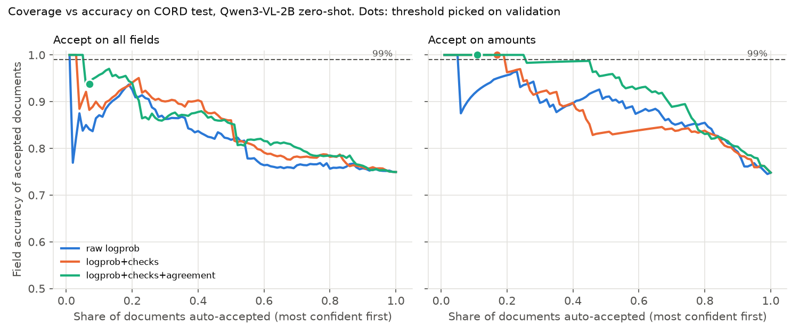
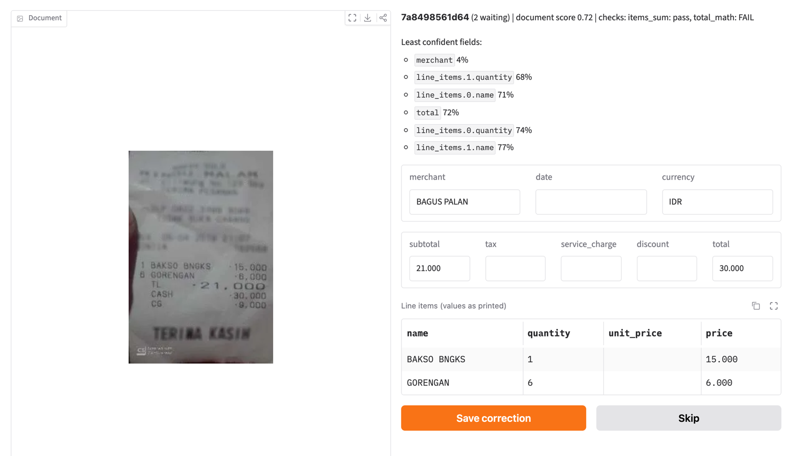

# doc-extraction-vlm

Receipts in, validated JSON out: merchant, date, currency, line items, subtotal, tax, service
charge, discount and total. I compare OCR + LLM, a small vision-language model zero-shot, the same
model fine-tuned with LoRA, and Donut as a CORD-trained reference, on accuracy, latency, cost,
image corruptions and an out-of-distribution set. The best general model then runs as a service
with schema validation, arithmetic checks, calibrated confidence and a review queue whose
corrections become training examples.

- **Qwen3-VL-2B zero-shot scores F1 81.8 on CORD test**, against 73.0 for docTR OCR + Qwen3-4B. It
  is also more robust (rotation costs it 5 points and OCR+LLM 30) and best out of distribution
  (SROIE F1 89.8 vs 86.6).
- **Donut, fine-tuned on CORD, is better in-distribution (90.5) and useless outside it:** 13.7 on
  SROIE, because its output vocabulary has no merchant or date.
- **Auto-accept:** with a threshold picked on validation for 99% accuracy, the service accepts
  **17% of test receipts, with every amount correct**. With every field in scope (item names
  matched exactly, unit price by CORD's convention), no single-model threshold reaches 99% on
  validation, so nothing is auto-accepted. More on that below.
- **The LoRA fine-tune (approach C) has not been run yet.** It needs a T4. The notebook is ready
  and the row stays empty until its results come back.

All numbers are on the 100 CORD-v2 test receipts or a fixed 100-receipt sample of SROIE, from
prediction files committed in `results/predictions/`. `make report` regenerates every table and
figure from them without a model.

## Results

| Approach | F1 | Line-item F1 | Amounts F1 | TED acc | JSON valid | Checks pass | s/page M4 (MPS) | s/page T4 | s/page CPU | $/1k pages |
|---|---|---|---|---|---|---|---|---|---|---|
| A. docTR OCR + Qwen3-4B (Ollama, Q4) | 73.0 | 70.5 | 82.7 | 69.1 | 100.0 | 54.1 | 7.5 | - | 12.5 (n=10) | 0.42 |
| B. Qwen3-VL-2B zero-shot | **81.8** | **81.9** | 81.4 | 82.8 | 100.0 | 69.0 | 10.9 | - | 205.9 (n=5) | 0.61 |
| C. Qwen3-VL-2B + LoRA on CORD | not run yet | | | | | | | | | |
| Donut (CORD fine-tuned, reference) | 90.5 | 89.1 | 95.5 | 91.5 (90.2 official) | 100.0 | 82.0 | 1.1 | - | 1.5 (n=10) | 0.06 |
| D. API model | not run (no key) | | | | | | | | | |

F1 is over every labelled or predicted field, with line items paired by Hungarian matching.
"Checks pass" is the share of checkable outputs whose arithmetic checks all hold; the
ground-truth labels themselves pass 95% of the time. Cost is measured latency times an assumed hourly price (M4 $0.20, T4 $0.35, CPU $0.10;
see `config.toml`), not a quote. CPU timings are on fewer pages because a 2B VLM on CPU takes
about 3.5 minutes per receipt.

**Robustness**: F1 on the first 40 CORD test receipts, each corrupted once with a fixed seed.

| Approach | clean | rotate 5-10° | blur | low-res (÷3) | JPEG q10 |
|---|---|---|---|---|---|
| A. OCR + LLM | 70.2 | 40.0 | 58.4 | 63.0 | 58.9 |
| B. Qwen3-VL-2B | 80.9 | 76.2 | 79.2 | 77.8 | 71.3 |
| Donut | 89.2 | 86.7 | 73.4 | 79.1 | 80.6 |

**Out of distribution**: SROIE, Malaysian receipts scored on merchant, date and total. CORD-v2
has no merchant or date labels, so this is also the only test of those fields.

| Approach | F1 | merchant | date | total | JSON valid |
|---|---|---|---|---|---|
| A. OCR + LLM | 86.6 | 69.0 | 96.0 | **94.9** | 100.0 |
| B. Qwen3-VL-2B | **89.8** | **85.4** | **98.5** | 85.4 | 99.0 |
| Donut | 13.7 | 0.0 | 0.0 | 30.3 | 94.0 |

**Auto-accept**: threshold chosen on CORD validation for 99% field accuracy, reported on test.

| Approach | Accept on | Signals | Test coverage | Test accuracy of accepted |
|---|---|---|---|---|
| B. Qwen3-VL-2B (shipped) | amounts | log-prob + checks | **17%** | **100%** |
| B. Qwen3-VL-2B | amounts | + agreement with A | 11% | 100% |
| B. Qwen3-VL-2B | all fields | log-prob + checks | 0% (no threshold reaches 99%) | - |
| B. Qwen3-VL-2B | all fields | + agreement with A | 7% | 93.8% |
| A. OCR + LLM | amounts | + agreement with B | 18% | 95.8% |



Calibration plots are in `results/figures/`. The full error taxonomy, about 1,000 wrong fields
sorted into 17 categories per approach, is in [evaluation/error_analysis.md](evaluation/error_analysis.md).
The decisions behind all of this are in [docs/design.md](docs/design.md).

## Service

`POST /extract` takes an image or a PDF (first page). It returns the parsed receipt, the check
results, a confidence per field, a document score and `accepted` or `review`.
Documents for review wait in a SQLite queue. The Gradio UI at `/review` shows the image beside
the editable fields, with the least confident fields listed above them. A saved correction is written to `data/corrections/` as
image + target JSON, the format the fine-tuning notebook picks up. Prometheus metrics are at
`/metrics/`: decisions, invalid outputs, latency, queue size and corrections.



## Run it

```bash
make setup && make data   # uv sync with all extras; download CORD-v2 and SROIE (~2.4 GB)
make report               # every table and figure above, from the committed predictions
make test                 # ruff + pytest; no model, no GPU (the service test replays recorded outputs)
make eval                 # recompute all predictions on a laptop, one model at a time (~3 h on an M4; needs `ollama serve`)
make serve                # API on :8000, review UI on :8000/review (Qwen3-VL-2B, ~5 GB on MPS)
make demo                 # docker compose: the API replaying recorded outputs + Prometheus on :9090
```

```bash
curl -F file=@tests/fixtures/cord-test-091.png localhost:8000/extract
```

Fine-tuning: open `notebooks/colab_finetune_vlm.ipynb` on Kaggle or Colab with a T4. It clones
this repo, trains, runs the same evaluation and writes `results.zip`. Unzip that here and run
`make report`. Training runs as `notebooks/train_lora.py`, one DDP process per GPU, and the
evaluations run as one queue per GPU. The notebook prints a runtime estimate per stage at the top,
stops starting new evaluations before Kaggle's 12-hour limit, and resumes from checkpoints or a
previous run's adapter.

## What didn't work or surprised me

- **99% on every field was out of reach for a single model.** Even validation receipts whose
  arithmetic checks all pass are only about 85% field-correct. The misses are mostly unit price
  (CORD labels it only when printed; the OCR+LLM pipeline fills it in, the VLM leaves it out even
  when printed) and exact item-name spelling. Accepting on the amounts instead gives 17% coverage
  with no errors on test. The item lines of an accepted receipt are not guaranteed.
- **The VLM computes totals.** On SROIE, 5 of its 14 wrong totals are subtotal + 6% GST on
  receipts that say "GST included in total". The arithmetic check passes, because the made-up
  total is consistent. Checks catch inconsistency, not consistent fabrication. OCR+LLM never did
  this, which is why it wins on SROIE totals.
- **Rotation breaks OCR+LLM (70 → 40).** I turned off docTR's page straightening because it
  doubled the time and didn't help upright scans. My line rebuilding groups words by vertical
  centre, which fails on slanted lines.
- **Ollama sorts JSON-schema properties alphabetically**, so the model writes `currency` before
  it has seen an item. In early runs it put the total there; field definitions in the prompt fixed
  it. Constrained output still edged out free JSON mode on 25 validation receipts (F1 0.773 vs
  0.764, within noise).
- **Raw docTR output reads a receipt column by column**: names in one block, prices in another.
  Rebuilding printed lines from word boxes (`layout_lines`) mattered more than the OCR model
  choice. Only 3 of OCR+LLM's 362 CORD errors are characters the OCR missed.

## Limitations

- 100 test receipts: differences of 3-4 F1 points are within noise. A vs B and Donut's SROIE
  collapse are not.
- Merchant and date confidence is uncalibrated: CORD has no labels to fit it on.
- SROIE merchant labels mix brand names and legal entities, so merchant F1 partly measures
  agreement with one annotator.
- The confidence model, the threshold and the CI fixtures are fitted to Qwen3-VL zero-shot.
  Switching the shipped model means rerunning `make report` and rebuilding the fixtures.
- No API row (D): it runs when `API_KEY` is set and is skipped otherwise.

Data: [CORD-v2](https://huggingface.co/datasets/naver-clova-ix/cord-v2) (CC BY 4.0) and
[SROIE](https://huggingface.co/datasets/jsdnrs/ICDAR2019-SROIE) (ICDAR 2019; CC BY 4.0 as stated
by the mirror). Downloaded by script; not committed, except three CORD test images used as CI
fixtures. Code: MIT.
